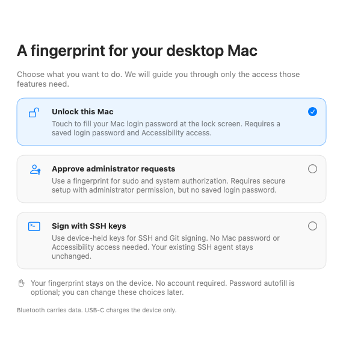
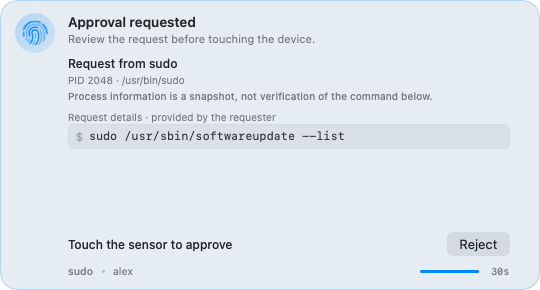
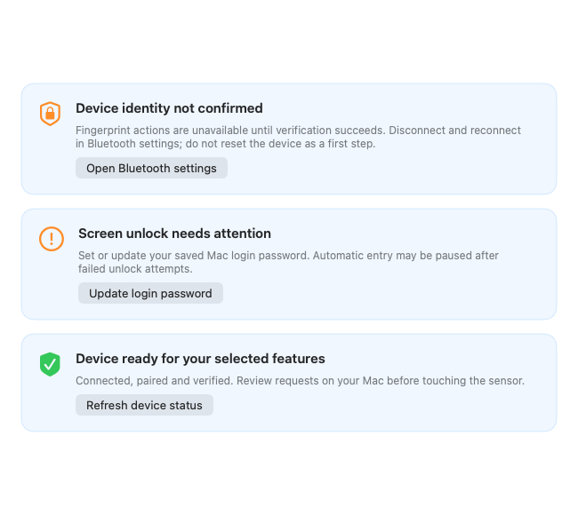

# Desktop Mac experience: review candidate

This branch makes immurok easier to set up and understand on a Mac without a Touch ID keyboard, while keeping permissions and credentials tied to the features the user chooses. It includes the PAM hardening described in [SECURITY-HARDENING.md](../SECURITY-HARDENING.md).

## Interactive preview (no installation)

[Open the preview file on GitHub](review-previews/interactive-preview.html), choose **Download raw file**, then open the downloaded HTML file in a current Safari, Chrome, or Firefox browser. GitHub displays source; it does not execute HTML previews inline.

From a checkout of this branch on macOS:

```sh
open docs/review-previews/interactive-preview.html
```

The preview is a self-contained, offline HTML simulation with no build step, external libraries, telemetry, persistent storage, or network requests. It never accesses Bluetooth, USB, Keychain, macOS permissions, or a shell. All actions and credentials are synthetic. Reloading starts over and clears sample history.

Suggested walkthrough:

1. Select **SSH signing** alone and complete setup: no login-password, Accessibility, or PAM step appears.
2. Reload, select **Screen unlock** and **Administrator approval**, and try **Set up later** on a prerequisite. The final checklist identifies incomplete setup.
3. Open **Approval dialogs** and select known-process, unknown-source, and SSH examples. Try Reject (or Escape while focused inside the preview), simulated fingerprint approval, and timeout.
4. Open **Device status** and select the connection, permission, unverified-device, prerequisite, and low-battery scenarios. Try their simulated recovery actions and clear sample approval history.

This browser approximation accompanies the native component screenshots below; it is not the SwiftUI app or a hardware test. The simulated fingerprint button and scenario selectors are review controls, not production approval bypasses. Recovery scenarios are independent demonstrations; they do not exercise the native readiness state machine. Icons use offline text substitutes. Actual macOS permission dialogs, authentication behavior, VoiceOver, and hardware still require native acceptance testing.

## User-visible changes

### Feature-led setup

The welcome screen offers screen unlock, administrator approval, and SSH signing as independent choices. Selecting a feature changes the remaining steps. SSH-only setup needs no saved Mac password, Accessibility permission, or PAM provisioning. Pairing no longer opens a password prompt automatically. Existing settings are retained when revisiting setup.

The sequence is Bluetooth connection → secure pairing → fingerprint enrollment → the selected feature's prerequisites → a readiness checklist. The wizard distinguishes Bluetooth connection from cryptographic verification, explains USB-C charging, supports skipping optional feature prerequisites, and enables only ready selected features on Done. A canceled or failed Keychain write no longer reports successful login-password configuration. Keychain updates preserve the previous item if an update fails.

The existing installer still places the PAM module and configures the PAM stack. This branch makes it fail closed when not provisioned; an optional-component installer is separate follow-up work. The onboarding does not claim to undo installer changes for SSH-only users.



### Clear approval prompts

Manual requests now receive context too; the overlay is no longer reserved for requests classified as AI-agent activity. Prompts show a best-effort OS socket-peer process snapshot, service, account, full scrollable request text when available, countdown, and an explicit Reject button. Keyboard Escape declines through the same callback. Invisible control and bidirectional-formatting characters in request text are escaped rather than allowed to hide or reorder content.

The UI explicitly distinguishes process information from requester-supplied command text. It does **not** claim to verify the actual command, prove intent, or bind a hardware touch to one operation. Missing details remain visibly unavailable. Fingerprint approval still requires touching the device; there is no software Approve button bypass.



### Actionable device state

The Device tab distinguishes Bluetooth permission/power failures, disconnection, missing pairing, unverified identity, missing fingerprints, login-password problems, missing Accessibility access, incomplete administrator setup, low battery, and readiness for selected features. Each state includes a next action. The menu's readiness summary no longer treats an SSH-only user as broken for having no saved login password.

A status refresh reads device status/battery and does not release a secret or enter a password. Battery data carries a last-reported time. Unverified identity directs users to reconnect instead of suggesting a destructive reset. The existing diagnostics and repair/uninstall paths remain available; they have not been certified against a live production installation.



### Privacy and integration

- SSH is scoped to explicitly configured clients by default. Becoming the session-wide agent is a separate opt-in. Restoring the prior agent only occurs if immurok still owns the session variable.
- Recent approval prompts appear in About as up to 50 categorical outcomes in memory. They contain no commands, account names, executable paths, key names, or secrets; Clear and app exit erase them. This is not a complete or tamper-evident audit log.
- Raw PAM/CLI request logging and a diagnostic key-name listing were removed. This is targeted reduction, not a claim that every existing diagnostic field has been independently privacy-audited.
- Automatic update checks and prevention of idle sleep remain explicit preferences from the hardening change.

## Validation

- Local arm64 release build succeeds with the installed macOS 26.5 SDK.
- PAM unit/policy tests pass; the missing-key regression fails on the original code and passes on the patched implementation.
- `tests-smoke/run.sh` checks feature prerequisites, readiness precedence, and untruncated/escaped request presentation without hardware or the installed app.
- XCTest coverage adds onboarding/status policy and bounded categorical history checks. Local execution requires a full Xcode toolchain; this machine's command-line tools do not contain XCTest. GitHub Actions provides the full suite.
- Production SwiftUI components were rendered with synthetic data and visually inspected. Images above are component previews, not screenshots of a live paired device. The production app was not installed or launched.
- JSON localization key parity and `git diff --check` are checked. New explanatory copy uses English fallbacks; native translations remain pending.

## Maintainer review and hardware acceptance

This is a draft implementation, not a secure-product certification. Please review the feature activation model, optional installer components, and presentation of requesting-process information before merging.

Hardware validation still needs a signed/notarized build: first pairing, returning users, second-host pairing, enrollment, reconnect challenge behavior, administrator key provisioning/cancellation, screen unlock and changed passwords, SSH signing, simultaneous requests, sleep/wake, update, uninstall, and managed/SSO Macs. Validate VoiceOver, keyboard navigation, long text and translations on supported OS versions and both CPU architectures.

Important security follow-ups remain:

1. Versioned app/firmware protocol for nonce/session/operation-bound approvals and replay rejection. A fresh connection challenge does not fix replay of the existing fingerprint notification.
2. Replace the service/time-scoped preauthorization bridges with request/process-bound authorization; prevent another request consuming the intended approval. Requester-supplied display text is not a security boundary.
3. Review device host authentication, cooldown/secret-read budgets, signed firmware rollback protection, enrollment authorization and physical security.
4. Independent security review, protocol fuzzing and broader authentication-stack recovery tests.

Do not deploy by disabling Gatekeeper, skipping peer-signature verification, or replacing only the app while leaving the old PAM module installed. The fork retains vendor signing pins and needs a properly signed release strategy.
